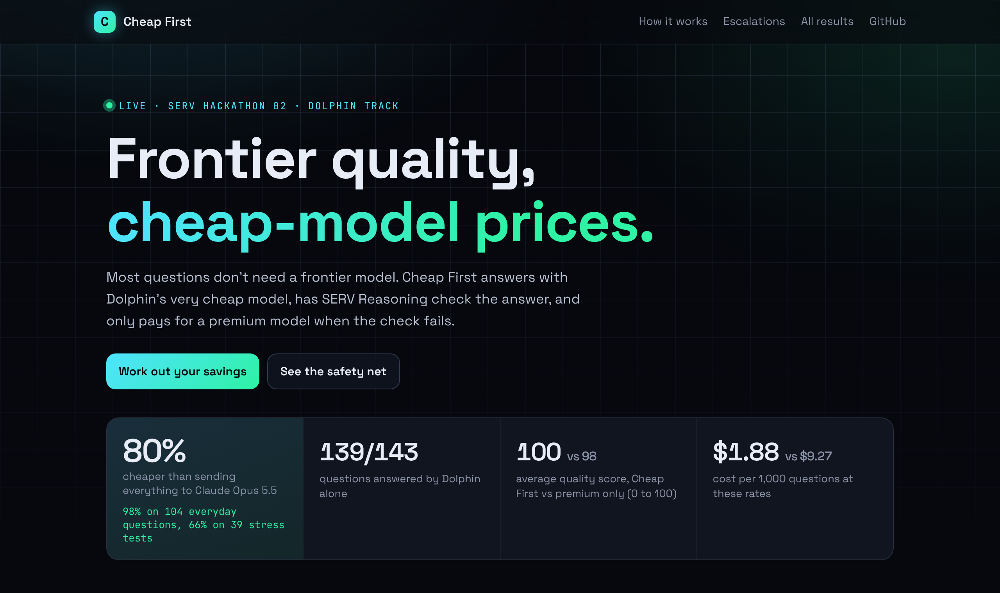
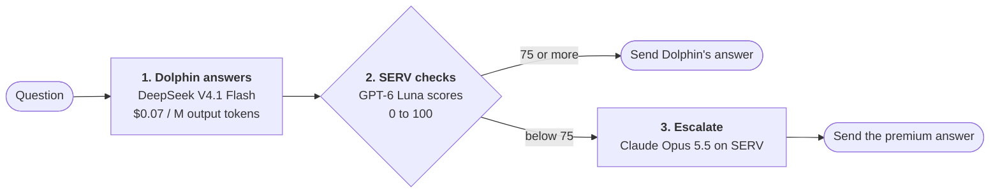
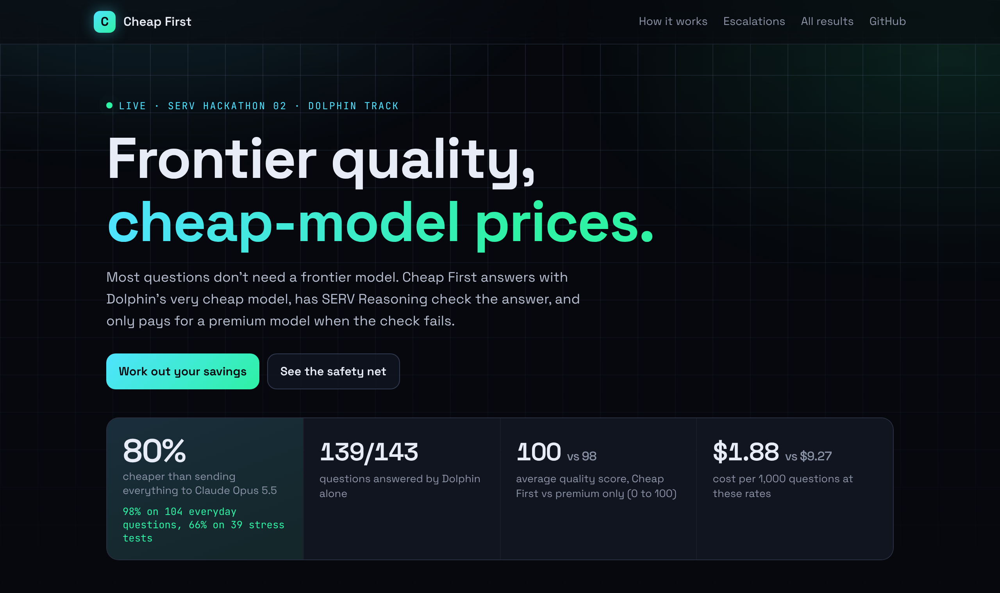

<h1 align="center">Cheap First</h1>

<p align="center">
  <b>Frontier quality at cheap-model prices.</b><br>
  Dolphin answers first. SERV Reasoning checks it. A premium model steps in only when the check fails.
</p>

<p align="center">
  <a href="https://robd-hub.github.io/cheap-first/"><b>Live results</b></a> ·
  <a href="#how-it-works">How it works</a> ·
  <a href="#results">Results</a> ·
  <a href="#run-it-yourself">Run it yourself</a>
</p>

<p align="center">
  
  
  
</p>

<p align="center">
  <a href="https://robd-hub.github.io/cheap-first/"></a>
</p>

## Why

Most questions don't need a frontier model, but teams send everything to one because they can't
tell in advance which answers will go wrong. Cheap First makes that call per question: the cheap
model answers, a cheap checker grades it, and only failing answers are paid for at frontier prices.

## How it works



1. **Dolphin answers.** DeepSeek V4.1 Flash on the [Dolphin](https://dphn.ai) network, at $0.01 in and $0.07 out per million tokens.
2. **SERV checks.** A small [SERV Reasoning](https://www.openserv.ai/) model scores the answer for correctness,
   whether it followed the instructions, and whether anything was made up.
3. **Escalate only if needed.** Below 75, the question goes to Claude Opus 5.5 on SERV and that answer is returned instead.

## Results

The benchmark runs every question two ways, Cheap First and premium only, and grades both final
answers with the same checker. Every cost comes from the token counts the APIs returned.

| | Cheap First | Premium only |
|---|---|---|
| Total cost, 143 questions | **$0.27** | $1.33 |
| Saving | **80%** (98% on 104 everyday questions, 66% on 39 stress tests) | |
| Answered by Dolphin alone | **139 of 143** | |
| Average quality score | **99.7** | 98.0 |

**The safety net works.** The checker escalated 4 questions. Three were real catches: a wrong
count, and blank answers on a 40-digit multiplication and the "world's hardest Sudoku". The premium
model got all three right. The fourth was a false alarm on a correct answer, and the page shows it
openly. In a separate test, the checker failed all 8 deliberately wrong answers it was given.

<p align="center">
  
</p>

## Run it yourself

```bash
npm install
export DOLPHIN_API_KEY=...   # from app.dphn.ai → API Keys
export SERV_API_KEY=...      # from console.openserv.ai
npm run ask -- "How many seconds are there in 3.5 hours?"
```

It prints the answer, which model gave it, the check score and what it cost. In your own code:

```ts
import { cheapFirst, defaultModels } from "./src/cheapFirst";

const result = await cheapFirst("Summarise this email in one line: ...", await defaultModels());
console.log(result.answer, result.answeredBy, result.costUsd);
```

| Command | What it does |
|---|---|
| `npm run ask -- "question"` | Answer one question the Cheap First way |
| `npm run benchmark` | Run the benchmark and save `data/results.json` (pass question ids to run just those) |
| `npm run build` | Build the results page into `out/` (no keys needed) |
| `npx tsx scripts/check-sanity.ts` | Grade deliberately wrong answers and save `data/checker-test.json` |
| `npx tsx scripts/probe.ts file.json` | Try questions on Dolphin and the checker only, to find ones Dolphin gets wrong |

## Project layout

```
src/models.ts          Dolphin and SERV API calls, with real per-call costs
src/cheapFirst.ts      answer → check → escalate
data/questions.json    143 questions with written criteria
data/results.json      the latest benchmark run
scripts/build-site.ts  builds the public results page
```

The site rebuilds on GitHub Pages whenever `main` changes. It is plain HTML built from
`data/results.json`, so no keys are ever used or exposed there.

<p align="center"><sub>Built for SERV Hackathon 02 · Dolphin + SERV Reasoning</sub></p>
