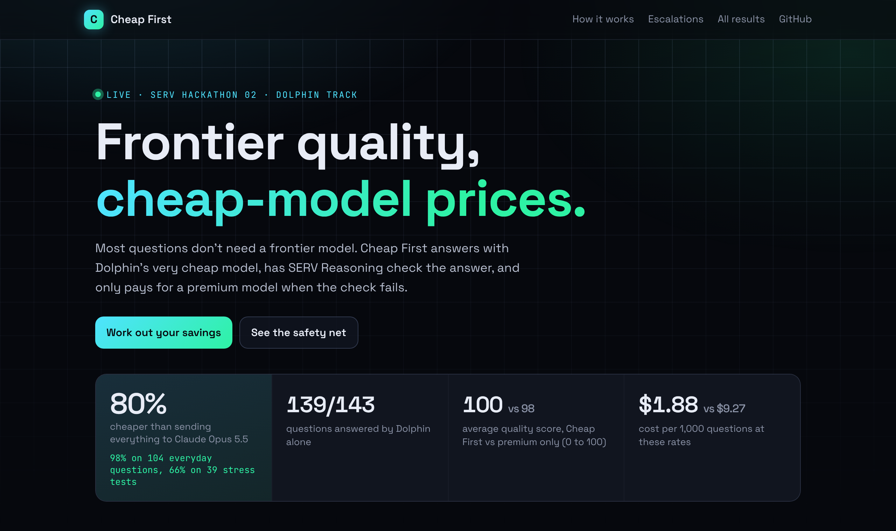
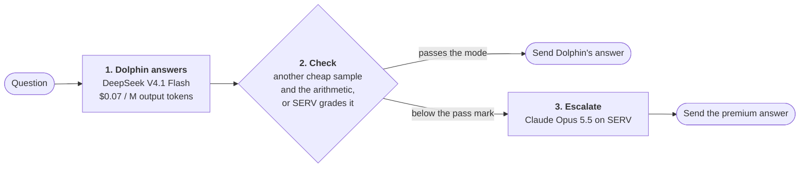
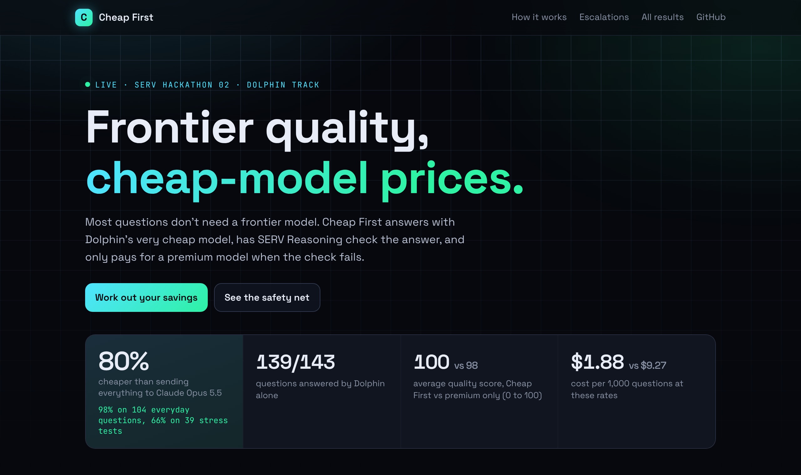

<h1 align="center">Cheap First</h1>
<p align="center">
<a href="https://parrot.designimp.com/agents/cheap-first?from=badge"></a>
</p>

<p align="center">
  <b>Frontier quality at cheap-model prices.</b><br>
  Dolphin answers first. SERV Reasoning checks it. A premium model steps in only when the check fails.
</p>

<p align="center">
  <a href="https://robd-hub.github.io/cheap-first/"><b>Live results</b></a> ·
  <a href="https://cheap-first.vercel.app/#try"><b>Try it</b></a> ·
  <a href="https://cheap-first.vercel.app/stats"><b>Live stats</b></a> ·
  <a href="https://youtu.be/QisYhwqbiME"><b>Demo video</b></a> ·
  <a href="https://x.com/agentreportcard/status/2120458951431159898">X post</a> ·
  <a href="#how-it-works">How it works</a> ·
  <a href="#results">Results</a> ·
  <a href="#run-it-yourself">Run it yourself</a>
</p>

<p align="center">
  
  
  <a href="https://robd-hub.github.io/agent-report-card/agents/cheap-first/"></a>
  
</p>

<p align="center">
  <a href="https://robd-hub.github.io/cheap-first/"></a>
</p>

## Why

Most questions don't need a frontier model, but teams send everything to one because they can't
tell in advance which answers will go wrong. Cheap First makes that call per question: the cheap
model answers, a cheap checker grades it, and only failing answers are paid for at frontier prices.

## How it works



1. **Dolphin answers.** DeepSeek V4.1 Flash on the [Dolphin](https://dphn.ai) network, at $0.01 in and $0.07 out per million tokens.
2. **Check.** A number or a multiple-choice question is checked by another cheap sample, which has to land on the same answer, and by evaluating any equation the answer wrote. Anything else is scored by a small [SERV Reasoning](https://www.openserv.ai/) model. Strict (85) asks for two extra samples and keeps the cheap answer only when they all agree. Balanced (75, the default) escalates when its one extra sample disagrees. Budget (60) keeps a disagreement, and escalates when an equation does not evaluate, when the cheap answer has no final number or choice, or when the grader scores below 60.
3. **Escalate only if needed.** Below the mode's pass mark, the question goes to Claude Opus 5.5 on SERV and that answer is returned instead.

## Results

These figures are the in-house set (`data/questions.json`). The benchmark runs every question two ways, Cheap First and premium only, and grades both final
answers with the same checker. Every cost comes from the token counts the APIs returned.

| | Cheap First | Premium only |
|---|---|---|
| Total cost, 143 questions | **$0.27** | $1.33 |
| Saving | **80%** (98% on 104 everyday questions, 66% on 39 stress tests) | |
| Answered by Dolphin alone | **139 of 143** | |
| Average quality score | **99.7** | 98.0 |

**The safety net works.** The checker escalated 4 questions. Three were real catches: a wrong
count, and blank answers on a 40-digit multiplication and the "world's hardest Sudoku". The premium
model got all three right. The fourth was a false alarm on a correct answer, and the page shows it
openly. In a separate test, the checker failed all 8 deliberately wrong answers it was given.

<p align="center">
  
</p>

### Public questions

The 143 questions above were written for this project. The table below is a fixed public sample, graded by code against the published answers. The checker did not see the answer key, and it does not mark the final answers.

**About 95.5% cheaper, 2 points behind the premium model on 300 public questions.**

| | Cheap First | Premium only (SERV · Claude Opus 5.5) |
|---|---|---|
| Correct, graded by code | **288/300 (96.0%)** | 294/300 (98.0%) |
| Cheap model alone (Dolphin · DeepSeek V4.1 Flash) | 288/300 (96.0%) | |
| Total cost | **$0.088** | $1.945 |
| Saving | **95.5%** | |
| Escalated | 5 of 300 (1.7%) | |
| Median latency | 6.1s | 2.7s |
| Mean latency | 12.7s | 2.7s |

| Set | Cheap First | Premium only | Cost |
|---|---|---|---|
| GSM8K test, 200 of 1,319 | 194/200 | 198/200 | $0.037 vs $1.304 |
| ARC-Challenge test, 100 of 1,172 | 94/100 | 96/100 | $0.051 vs $0.641 |

Cheap First is slower: median 6.1s vs 2.7s, mean 12.7s vs 2.7s. It is 2 points behind the premium model (96.0% vs 98.0%). It scored the same as the cheap model alone, 288 of 300. The checker made 0 real catches, let 11 wrong cheap answers through, and 4 of the 5 escalations were false alarms on answers the cheap model already had right. 1 escalation was still wrong.

Seed 20261120. Models: Dolphin · DeepSeek V4.1 Flash answers, SERV · GPT-6 Luna (checker) checks, SERV · Claude Opus 5.5 is the premium model. Run 2026-11-20 13:24 UTC. Full rows: [data/public-benchmark.json](https://github.com/robd-hub/cheap-first/blob/main/data/public-benchmark.json).

File hashes for that sample are in `src/publicSets.ts` and in the JSON. `npm run public-benchmark` repeats the run. `--dry-run` checks the files without calling a model.

### Harder questions

A fair criticism of the benchmark above is that the questions were too easy. So there is a
[hard benchmark](docs/hard-benchmark.md): 97 hard, real-world style questions (multi-step maths,
trick facts, strict format rules, failing tools, messy data, plus a "breaking point" round). Every
answer is graded by code against a known correct answer, and the checker gets no answer key.

| 97 hard questions | Cheap First | Premium only |
|---|---|---|
| Correct, checked by code | **97 of 97** | 97 of 97 |
| Total cost | **$0.27** | $1.42 |
| Saving | **81%** | |

To test the checker on real mistakes, three weaker models answered the same questions: of 124
wrong answers, **the checker caught 115 (93%)**. Of the 9 it missed, 5 were only a wrong status label
and 4 were real errors, mostly facts the checker also got wrong. It raised false alarms on 13 of 166
right answers (8%). Full details, including the weak spots, are in [docs/hard-benchmark.md](docs/hard-benchmark.md).

## Run it yourself

```bash
npm install
export DOLPHIN_API_KEY=...   # from app.dphn.ai → API Keys
export SERV_API_KEY=...      # from console.openserv.ai
npm run ask -- "How many seconds are there in 3.5 hours?"
```

It prints the answer, which model gave it, the check score and what it cost. In your own code:

```ts
import { cheapFirst, defaultModels } from "./src/cheapFirst";

const result = await cheapFirst("Summarise this email in one line: ...", await defaultModels());
console.log(result.answer, result.answeredBy, result.costUsd);
```

| Command | What it does |
|---|---|
| `npm run ask -- "question"` | Answer one question the Cheap First way |
| `npm run benchmark` | Run the benchmark and save `data/results.json` (pass question ids to run just those) |
| `npm run public-benchmark` | Run the pinned GSM8K + ARC-Challenge sample and save `data/public-benchmark.json` (`-- --dry-run` checks the files only). A finished file is left as it is unless you pass `--rerun` |
| `npm run public-tune` | Draw a disjoint tuning sample (seed 20261121, 40 GSM8K + 20 ARC) and save `data/public-tuning.json` (`-- --dry-run` checks the draw only) |
| `npm run public-compare` | Replay the new check on the published 300, reusing cached cheap and premium answers, and save `data/public-compare.json` (`-- --dry-run` makes no model calls) |
| `npm run hard-benchmark` | Run the hard benchmark, graded by code (`-- --set stress` for round 2, see [docs](docs/hard-benchmark.md)) |
| `npm run build` | Build the results page into `out/` (no keys needed) |
| `npx tsx scripts/check-sanity.ts` | Grade deliberately wrong answers and save `data/checker-test.json` |
| `npx tsx scripts/probe.ts file.json` | Try questions on Dolphin and the checker only, to find ones Dolphin gets wrong |

## Live demo server

`api/ask.ts` is a small serverless function (deployed on Vercel, see `vercel.json`) that powers the
"Try it live" box on the results page. The keys stay on the server. Every call spends real credits, so
it limits questions to 600 characters, 10 an hour per visitor and 300 a day per server
(`CF_PER_IP_PER_HOUR`, `CF_DAILY_CAP`), and `CF_MAX_TOKENS` caps each model reply. The GitHub Pages
build points that box at `https://cheap-first.vercel.app/api/ask`.

[Live stats](https://cheap-first.vercel.app/stats) (`/stats`, JSON at `/api/stats?format=json`) count production answers after they are delivered: how many, how often the premium model was used, dollars against always-premium pricing, and real catches. A real catch is a non-blank cheap answer the check scored below that request's pass mark, so the premium model answered. Catches are split by signal: a disagreeing cheap sample, an equation that did not evaluate, or the grader. The page does not keep the question or either answer, so a catch is the check's decision, not a separate proof the cheap answer was wrong. Escalations where Dolphin returned nothing are counted in the escalation rate and shown apart from catches.

The counters use the same Upstash Redis as the other shared limits (`KV_REST_API_URL` and `KV_REST_API_TOKEN`, or `UPSTASH_REDIS_REST_URL` and `UPSTASH_REDIS_REST_TOKEN`). The free plan is enough. If prepaid keys are already connected, no further storage is required. Until one of those pairs is set, the page stays empty and records nothing. **Since** is the time of the first recorded answer. Traffic from before that is not backfilled. For an answer Dolphin kept, the premium price is the estimate the API already returns as `savedUsd` (premium rates on the cheap call's tokens), not a second model call. The saving can be negative when an escalation costs more than that.

### Spend guards (free demo and paid `api/pay.ts`)

An escalation to the premium model can cost far more than the $0.005 a paid answer earns (one benchmark
escalation cost $0.19), so both endpoints:

- cap each premium answer at `CF_PREMIUM_MAX_TOKENS` tokens (default 2000, so at most about $0.05),
- stop escalating once a server instance has spent its daily premium budget
  (`CF_PAID_PREMIUM_BUDGET_USD`, default $2; `CF_DEMO_PREMIUM_BUDGET_USD`, default $1). A paid
  request that would need the premium model after that gets a 503 and is never charged,
- go straight to the premium model when Dolphin errors out or returns a blank answer, instead of failing
  or paying to check an empty reply. The benchmark keeps outages visible and does not fall back.

The paid endpoint accepts questions of up to 2,000 characters, and an optional `mode`:
`strict` (pass mark 85, escalates more often), `balanced` (75, the default) or `budget` (60).
Each answer includes `costUsd` and `savedUsd` (the saving against the premium model alone; an
estimate for cheap answers, and it can be negative for an escalation).

## OpenAI-compatible API

`api/v1/chat/completions.ts` serves Cheap First in the OpenAI chat completions format, paid per answer
with x402 like `/api/pay`. An app using an OpenAI-style client changes its base URL to
`https://cheap-first.vercel.app/api/v1` and wraps `fetch` with an x402 client. It supports `messages`
(system, user, assistant, up to 6,000 characters in total), `model` (`cheap-first`, `cheap-first-strict`,
`cheap-first-budget`) and `stream` (the answer arrives as a single chunk, since it is only released after
the check). Each reply has a `cheap_first` field with who answered, the check score, the cost and the
saving. `GET /api/v1/models` lists the model names.

## MCP: Claude, Cursor, and other agents

Cheap First speaks the [Model Context Protocol](https://modelcontextprotocol.io) over Streamable HTTP, on the same deployment as the rest of the API:

```
https://cheap-first.vercel.app/mcp
```

`https://cheap-first.vercel.app/api/mcp` is the same endpoint. It is stateless: one JSON-RPC message per POST, no session.

| Tool | What you send | What you get back |
|---|---|---|
| `ask_cheap_first` | `question`, and an optional `mode` of `strict`, `balanced` (default) or `budget` | `answer`, `escalated`, `checkScore` (0 to 100), `costUsd`, and `savedUsd` (the estimated saving against the premium model alone; it can be negative when an escalation costs more) |
| `cheap_first_stats` | nothing | The published benchmarks: the in-house 143 questions ($0.27 against $1.33), the harder 97-question run, and the public 300-question run (about 95.5% cheaper, 2 points behind the premium model) |

Free calls use the demo limits above: 600 characters, 10 an hour from one IP, 300 a day, and the demo's premium budget. They share those counters with `/api/ask`, so using both does not double the free tier. A prepaid key sent as `Authorization: Bearer cf_...` is charged one credit through the same path as `/api/pay`. An x402 payment of $0.005 USDC on Base works too. Send the header `X-Cheap-First-Paid: 1` and the endpoint replies 402 with the usual challenge, then settles only after the answer is ready. The price is the same $0.005. Card payments stay off until Stripe is configured, which this server does not turn on.

### Cursor

In `~/.cursor/mcp.json` (everywhere) or `.cursor/mcp.json` in a project. Leave `headers` out for the free demo. `${env:CHEAP_FIRST_API_KEY}` is read from the environment Cursor was launched with.

```json
{
  "mcpServers": {
    "cheap-first": {
      "url": "https://cheap-first.vercel.app/mcp",
      "headers": {
        "Authorization": "Bearer ${env:CHEAP_FIRST_API_KEY}"
      }
    }
  }
}
```

### Claude Desktop and Claude Code

In Claude Desktop: Settings → Connectors → Add custom connector, and paste `https://cheap-first.vercel.app/mcp`. Add the bearer header there if you have a prepaid key.

Claude Code, in `.mcp.json`:

```json
{
  "mcpServers": {
    "cheap-first": {
      "type": "http",
      "url": "https://cheap-first.vercel.app/mcp",
      "headers": {
        "Authorization": "Bearer ${CHEAP_FIRST_API_KEY}"
      }
    }
  }
}
```

### Clients that only launch a local process

`src/mcpStdio.ts` reads MCP messages on stdin and posts them to the hosted endpoint, so the demo limits and payments still happen on the server. From a checkout of this repo (`npm install` first):

```json
{
  "mcpServers": {
    "cheap-first": {
      "command": "npx",
      "args": ["tsx", "src/mcpStdio.ts"],
      "env": {
        "CHEAP_FIRST_API_KEY": "cf_..."
      }
    }
  }
}
```

`npm run mcp` runs the same bridge. `CHEAP_FIRST_MCP_URL` overrides the endpoint. `CHEAP_FIRST_PAID=1` sends the x402 header. The package is not on npm yet, so `npx` only works inside a checkout, where `tsx` is installed.

## Listing in MCP directories

`server.json` is the metadata for the official MCP Registry. `.mcp.json` is the free demo: `https://cheap-first.vercel.app/mcp` and no headers. The registry entry can also offer an optional `Authorization: Bearer cf_...` prepaid key, and an optional `X-Cheap-First-Paid: 1` header that asks for the $0.005 USDC on Base challenge. Leave both empty for the free demo. Its icon is `https://cheap-first.vercel.app/icon.png`, which the site build copies from `brand/icon.png`.

To publish a change, raise `version` in `server.json` and `SERVER_VERSION` in `src/mcp.ts` together (the registry refuses a version it already has), then run these yourself:

1. Install `mcp-publisher` (`brew install mcp-publisher`, or the binary from the [registry releases](https://github.com/modelcontextprotocol/registry/releases)).
2. Run `mcp-publisher validate`.
3. Run `mcp-publisher login github`.
4. Run `mcp-publisher publish`.

Then submit the same server at [cursor.directory](https://cursor.directory/plugins/new?type=mcp_server). The form reads `.mcp.json` from this repo.

## Output verifier: check an agent's work before paying it

`api/verify.ts` sells the Cheap First checker on its own. Send `{"task": "...", "answer": "...", "criteria": "optional", "passMark": 75}` and get `{"verdict": "pass" | "fail", "score", "reason", "receipt"}`. The buyer's own code pays the hired agent only on a pass, so we never hold anyone's money.

| Endpoint | Checker | Price (x402, USDC on Base) |
| --- | --- | --- |
| `POST /api/verify` | SERV · GPT-6 Luna | $0.02 |
| `POST /api/verify/quick` | Dolphin · DeepSeek V4.1 Flash | $0.005 |
| `POST /api/verify/free` | Dolphin, 20 a day per caller, 300 a day in all | free |

The task and answer aren't stored. The receipt holds their SHA-256 fingerprints, the verdict and the time. Payment is settled only after the verdict is ready. `npm run verify-test` runs 7 right, wrong, rule-breaking and made-up answers through both levels (14/14 as expected on 2026-11-18).

## Pay by card: prepaid keys (needs Stripe and Upstash)

For developers without a crypto wallet, a card payment can buy a prepaid key: one answer per $0.005 paid
($5 = 1,000 answers). The key works as `Authorization: Bearer cf_...` on `/api/pay` and `/api/v1/chat/completions`
(so it's simply the `apiKey` in an OpenAI client). A failed answer gives its credit back. `GET /api/key` with the
key returns how many answers are left. Only a hash of each key is stored.

To switch it on:
1. Connect Upstash Redis to the Vercel project (Vercel → Storage / Marketplace → Upstash, free plan). This also
   makes the demo limits and premium budgets shared across server instances. Keys refuse to work without it.
2. In Stripe, create a Payment Link (for example $5, "1,000 Cheap First answers"). Under "After payment", choose
   "Don't show confirmation page" and redirect to `https://cheap-first.vercel.app/api/key?session={CHECKOUT_SESSION_ID}`.
3. Add `STRIPE_SECRET_KEY` in Vercel (a restricted key with "Checkout Sessions: read" is enough), and
   `CF_CARD_LINK` (the Payment Link URL) in Vercel and as a repository variable for the Pages build, so the site shows the card option.

After paying, the buyer lands on a page that shows their key once. Refreshing can't mint a second key.

## Project layout

```
src/models.ts          Dolphin and SERV API calls, with real per-call costs
src/cheapFirst.ts      answer → check → escalate
src/budget.ts          daily premium spend limit for the live endpoints
api/ask.ts             the live "try it" endpoint
api/pay.ts             the paid x402 endpoint ($0.005 per answer)
api/mcp.ts             MCP endpoint (Streamable HTTP), also served at /mcp
api/v1/                the same paid answer, in the OpenAI chat completions format
src/mcp.ts             MCP protocol and the two tools
src/mcpStdio.ts        stdio bridge for local MCP clients (npm run mcp)
src/limits.ts          demo rate limits, shared by /api/ask and free MCP calls
src/paid.ts            the shared x402 verify → answer → settle flow (or a prepaid key)
src/keys.ts, api/key.ts  prepaid keys bought by card (src/stripe.ts)
src/store.ts           shared counters on Upstash, with an in-memory fallback
src/liveStats.ts       aggregate production counters for /stats (no prompts or keys)
src/publicSets.ts      pinned GSM8K and ARC-Challenge sample
api/stats.ts           the public /stats page and its JSON
data/questions.json    143 questions with written criteria
data/results.json      the latest in-house benchmark run
data/public-benchmark.json  the public GSM8K and ARC-Challenge run (300 questions, complete)
scripts/public-benchmark.ts
scripts/build-site.ts  builds the public results page
```

The site rebuilds on GitHub Pages whenever `main` changes. It is plain HTML built from
`data/results.json`, so no keys are ever used or exposed there.

<p align="center"><sub>Built for SERV Hackathon 02 · Dolphin + SERV Reasoning</sub></p>

## License

MIT, see [LICENSE](LICENSE).
